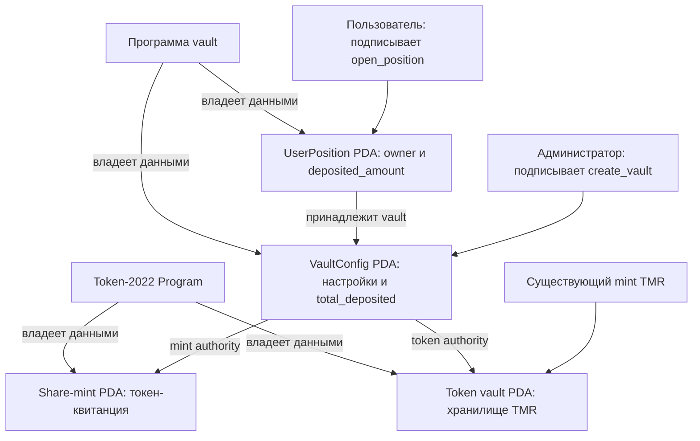

# Неделя 8 — каркас vault

**Автор:** Медиханов Тимур · **Рубежный контроль 1**

Anchor-программа создаёт настройки vault, новый share-токен, хранилище
принимаемых токенов и отдельные позиции пользователей. Настройки vault
одновременно служат PDA authority для share-mint и хранилища.

В неделе 8 реализованы две инструкции: `create_vault` и `open_position`.
Все счётчики и токеновые балансы после создания равны нулю. SOL расходуются
на rent аккаунтов и комиссии транзакций. Пополнение, выпуск квитанций при
депозите и вывод токенов относятся к дальнейшему развитию vault.

**Статус Devnet:** сборка и локальные проверки выполнены; деплой ожидает
пополнения кошелька администратора тестовыми SOL.

## Связь с предыдущими неделями

В неделе 6 уже использовались PDA и отдельные аккаунты пользователей.
В неделе 7 был создан принимаемый токен TMR на Token-2022. Эти работы дают
основу для vault, однако mint TMR управлялся кошельком, а настроек vault,
share-mint и позиций в тех проектах не было. Здесь они объединены
в самостоятельную программу в каталоге `vault/`.

В демонстрации принимается существующий TMR. Share-токен создаётся отдельно:
он представляет будущую долю пользователя в vault и выпускается только
через подпись PDA программы.

## Схема аккаунтов



| Аккаунт | Что хранится | Программа-владелец данных (`AccountInfo.owner`) | Кто управляет |
|---|---|---|---|
| `VaultConfig` | `admin`, `asset_mint`, `share_mint`, `token_vault`, `total_deposited`, `bump` | Программа vault | Логика vault; администратор подписывает создание |
| `share_mint` | Decimals как у принимаемого mint, supply, mint authority | Выбранная SPL Token Program | Mint authority — PDA `VaultConfig`; freeze authority отсутствует |
| `token_vault` | Принимаемый mint, баланс, token authority | Выбранная SPL Token Program | Token authority — PDA `VaultConfig`; delegate и отдельной close authority нет |
| `UserPosition` | `vault`, `owner`, `deposited_amount`, `bump` | Программа vault | Пользователь подписывает создание собственной позиции |

Владение данными и право распоряжаться токенами — разные поля. Token-2022
владеет данными mint и token account, а для выпуска и перевода проверяет
authority. В каркасе этой authority назначена PDA vault, у которой нет
приватного ключа. Администратор не может подписать прямую операцию SPL Token
от её имени.

Сохраняется upgrade authority программы: она позволяет обновлять код.
Поэтому права PDA защищают от прямых операций кошелька, а доверие к будущим
обновлениям зависит от управления upgrade authority.

### Адреса PDA и размеры

Все PDA вычисляются с Program ID vault и каноническим bump:

| Аккаунт | Seeds | Размер |
|---|---|---|
| Настройки | `["vault", admin, asset_mint]` | 145 байт: 8 discriminator + 137 данных |
| Share-mint | `["share_mint", vault]` | 82 байта для mint без расширений |
| Хранилище | `["token_vault", vault]` | 178 байт для TMR, включая `TransferFeeAmount`; 165 для обычного SPL Token |
| Позиция | `["position", vault, user]` | 81 байт: 8 discriminator + 73 данных |

Один администратор может создать по одному vault для каждого принимаемого
mint. Повторное создание той же пары отклоняется. У пользователя одна
позиция в конкретном vault; адреса позиций разных пользователей различаются.

## Выполненные пункты задания

| Требование | Реализация |
|---|---|
| Схема аккаунтов и их владельцев | Диаграмма, таблица владельцев и seeds в этом README |
| Один раз создать настройки, share-токен и хранилище | `create_vault`: три аккаунта создаются атомарно через `init` |
| Только программа выпускает share-токен | `mint::authority = vault`; приватного ключа этой authority нет |
| Программа распоряжается хранилищем | `token::authority = vault`; прав кошелька администратора нет |
| Карточка пользователя по его адресу | `open_position`: PDA из vault и подписавшего пользователя |
| Деплой и аккаунты в Devnet | Подготовлены программа и клиент; требуется пополнение для деплоя |
| Короткая защита | Ответы на контрольные вопросы приведены ниже |

Исходники инструкций и структур: [programs/vault/src/lib.rs](programs/vault/src/lib.rs).

## Сборка и проверка

Использованы Anchor 1.2.0, Agave / Solana CLI 4.3.0,
SBF platform-tools 1.57, LiteSVM 0.17.0 и Node.js 25.6.1.
Версии Rust-зависимостей зафиксированы в `Cargo.lock`, клиента —
в `client/package-lock.json`. Для сборки нужен установленный `cargo-build-sbf`.

Из корня репозитория:

```bash
cd vault
cargo build-sbf --manifest-path programs/vault/Cargo.toml --arch v2 -- --locked
cargo test --locked

cd client
npm ci
node --check vault.mjs
```

Перед Rust-тестами обязательно собрать `target/deploy/vault.so`:
LiteSVM исполняет этот SBF-байткод. Сгенерированный IDL находится
в [idl/vault.json](idl/vault.json). При изменении программы обновите его
через Anchor CLI, чтобы клиент соответствовал инструкциям и данным аккаунтов.

12 октября 2026 года прошли **8 интеграционных тестов**:

- Создание пустого vault для SPL Token и Token-2022 с правильными authority.
- Создание хранилища для снимка реального TMR с расширением комиссии.
- Создание отдельных пустых позиций двух пользователей.
- Отклонение повторного создания vault и позиции.
- Отклонение попытки пользователя создать позицию по чужому адресу.
- Отклонение mint, не принадлежащего выбранной Token Program; откат аккаунтов.
- Запрет администратору выпускать share-токены и менять mint authority.
- Запрет администратору менять authority или закрывать хранилище.

Тесты: [programs/vault/tests/test_vault.rs](programs/vault/tests/test_vault.rs).
Происхождение публичного снимка TMR:
[fixtures/README.md](programs/vault/tests/fixtures/README.md).

JavaScript-клиент дополнительно проверен на локальном валидаторе с копией
TMR из Devnet: создание vault, открытие позиций двух пользователей,
повторный запуск `demo` и просмотр без кошелька через `show`.

## Клиент и воспроизведение

Просмотр опубликованного vault не требует приватного ключа:

```bash
cd vault/client
npm ci
node vault.mjs show
node vault.mjs show АДРЕС_ПОЛЬЗОВАТЕЛЯ
```

До деплоя и создания аккаунтов команда `show` сообщит, что vault не создан.

Для создания своего vault в опубликованной программе создайте кошелёк
в игнорируемой папке `vault/keys/` и пополните его Devnet SOL:

```bash
cd vault
mkdir -p keys
solana-keygen new --outfile keys/wallet.json
solana airdrop 2 --keypair keys/wallet.json --url devnet

cd client
node vault.mjs demo
```

`demo` создаёт vault и позицию подписанта, затем читает аккаунты и проверяет
authority. Повторный запуск читает существующие аккаунты. Новый кошелёк
создаёт собственный vault для того же TMR.

Открыть позицию другого пользователя в vault из демонстрации:

```bash
cd vault/client
WALLET=/полный/путь/к/кошельку.json node vault.mjs open
```

Пользователь оплачивает rent своей позиции и подписывает транзакцию.
Переменные окружения клиента: `WALLET` — файл подписанта, `ADMIN` —
администратор выбранного vault, `ASSET_MINT` — принимаемый mint,
`RPC_URL` — адрес RPC. По умолчанию используются Devnet и TMR из недели 7.
Для собственного vault при `show` или `open` укажите его `ADMIN`.

### Деплой собственной копии

Создайте отдельный ключ программы и согласуйте его адрес в `declare_id!`,
`Anchor.toml` и IDL, затем пересоберите программу. Ключ программы из этой
демонстрации хранится только локально.

```bash
cd vault
solana-keygen new --outfile keys/vault-keypair.json
solana address --keypair keys/vault-keypair.json
# Обновите Program ID, пересоберите SBF и IDL.
solana-keygen new --outfile keys/buffer-keypair.json
solana program deploy target/deploy/vault.so \
  --program-id keys/vault-keypair.json \
  --buffer keys/buffer-keypair.json \
  --keypair keys/wallet.json --url devnet --use-rpc
```

Для деплоя нужны Devnet SOL на rent байткода и комиссии; временный buffer
тоже требует rent до завершения деплоя. Если RPC airdrop недоступен,
используйте [официальный Devnet faucet](https://faucet.solana.com/).
Файлы `keys/`, `target/` и `node_modules/` исключены из Git.

## Devnet и Explorer

Подготовленный Program ID:
`J6x4mnjWyfsAYVVd1zNSfJwf9FG1k1LNwzjkoodkKmnN`.
Существующий принимаемый mint:
[TMR](https://explorer.solana.com/address/Cq9bsK12BiRunwpBNhGG9K8Di9QX4G2xfCcoG7TmmU31?cluster=devnet).
Ссылки на созданные аккаунты и транзакции добавляются после успешного деплоя.

У принимаемого TMR есть комиссия за перевод. При будущем добавлении депозитов
нужно учитывать реально полученное хранилищем количество и удержанную комиссию;
текущая неделя создаёт только пустой каркас.

## Вопросы для защиты

**Почему share-токен выпускает программа, а не администратор?**

Share-токен должен подтверждать долю пользователя. Если человек может
выпускать его произвольно, он создаст квитанции без соответствующих вкладов.
Поэтому mint authority назначена PDA vault. В дальнейшем выпуск выполняется
через CPI `mint_to` с `invoke_signed` после проверки депозита. В текущем
каркасе supply равен нулю.

**Что такое PDA и почему у неё нет приватного ключа?**

Program Derived Address вычисляется из seeds, Program ID и bump.
Solana подбирает адрес вне кривой Ed25519, поэтому обычная подпись приватным
ключом для него невозможна. Рантайм разрешает программе подписать CPI
за свой PDA через `invoke_signed`, проверяя совпадение seeds и адреса.

**Как найти карточку конкретного пользователя?**

Вычислить PDA по известным vault, кошельку пользователя и Program ID:

```javascript
const [position] = web3.PublicKey.findProgramAddressSync(
  [Buffer.from('position'), vault.toBuffer(), user.toBuffer()],
  program.programId,
);
```

Список всех пользователей для этого не нужен. Затем аккаунт можно прочитать
через `program.account.userPosition.fetch(position)` или RPC `getAccountInfo`.

**Зачем нужны четыре аккаунта?**

`VaultConfig` связывает настройки и хранит общий счётчик. Share-mint задаёт
токен-квитанцию и право выпуска. Token vault хранит принимаемые токены.
`UserPosition` хранит принадлежность и вклад конкретного пользователя.
Первые три создаёт администратор; свою позицию создаёт пользователь.

Официальные пояснения Anchor:
[создание mint и PDA authority](https://www.anchor-lang.com/docs/tokens/basics/create-mint),
[token accounts и их владельцы](https://www.anchor-lang.com/docs/tokens/basics/create-token-account).
